# Práctica 1.5 · HTTPS con Let's Encrypt y Certbot

**Despliegue de Aplicaciones Web · 2º DAW · Curso 2026/2027**
**Alumno:** Francisco López Lobanova · GitHub: [Frxnker](https://github.com/Frxnker)

En esta práctica se instala una pila LAMP en una instancia EC2 de AWS con Ubuntu Server y se configura HTTPS en Apache con un certificado SSL/TLS **emitido por Let's Encrypt**. El certificado se obtiene con **Certbot**, que además configura Apache, redirige HTTP a HTTPS y programa la renovación automática. Todo el proceso está automatizado con scripts de Bash.

**Sitio desplegado:** [https://fran-https.ddns.net](https://fran-https.ddns.net)

---

## Índice

- [Práctica 1.5 · HTTPS con Let's Encrypt y Certbot](#práctica-15--https-con-lets-encrypt-y-certbot)
  - [Índice](#índice)
  - [1. Conceptos básicos](#1-conceptos-básicos)
  - [2. Creación de la instancia](#2-creación-de-la-instancia)
    - [Grupo de seguridad](#grupo-de-seguridad)
    - [IP elástica](#ip-elástica)
  - [3. Registro del dominio y DNS](#3-registro-del-dominio-y-dns)
  - [4. Estructura del repositorio](#4-estructura-del-repositorio)
  - [5. Variables de configuración (.env)](#5-variables-de-configuración-env)
  - [6. Instalación de la pila LAMP](#6-instalación-de-la-pila-lamp)
  - [7. Obtención del certificado con Certbot](#7-obtención-del-certificado-con-certbot)
    - [7.1. VirtualHost con el dominio](#71-virtualhost-con-el-dominio)
    - [7.2. Instalación de Certbot](#72-instalación-de-certbot)
    - [7.3. Solicitud del certificado](#73-solicitud-del-certificado)
  - [8. Cambios que hace Certbot en Apache](#8-cambios-que-hace-certbot-en-apache)
    - [8.1. Redirección de HTTP a HTTPS](#81-redirección-de-http-a-https)
    - [8.2. VirtualHost HTTPS](#82-virtualhost-https)
    - [8.3. Archivos del certificado](#83-archivos-del-certificado)
  - [9. Comprobación](#9-comprobación)
    - [9.1. Certificado instalado y renovación automática](#91-certificado-instalado-y-renovación-automática)
    - [9.2. Redirección HTTP → HTTPS](#92-redirección-http--https)
    - [9.3. Acceso desde el navegador](#93-acceso-desde-el-navegador)
  - [10. Cómo reproducir el despliegue](#10-cómo-reproducir-el-despliegue)
  - [Referencias](#referencias)

---

## 1. Conceptos básicos

| Concepto | Descripción |
|---|---|
| **HTTPS** | HTTP sobre una capa de transporte cifrada (TLS). Necesita un certificado emitido por una Autoridad de Certificación (CA) |
| **Let's Encrypt** | CA gratuita y automatizada, lanzada en 2016, que emite certificados X.509 para TLS |
| **ACME** | Protocolo con el que Let's Encrypt comprueba que controlamos el dominio antes de emitir el certificado |
| **Certbot** | Cliente ACME recomendado por Let's Encrypt. Obtiene, instala y renueva el certificado |

A diferencia del certificado autofirmado de la práctica 1.4, este certificado lo firma una CA reconocida, así que el navegador lo acepta **sin mostrar ningún aviso**.

Para emitirlo, Let's Encrypt hace una petición HTTP al dominio (reto *HTTP-01*) y comprueba que responde nuestro servidor. Por eso el dominio tiene que apuntar a la IP de la instancia y el puerto 80 tiene que estar abierto.

---

## 2. Creación de la instancia

| Parámetro | Valor |
|---|---|
| Nombre | `Practica01-05` |
| Región | `us-east-1` (Norte de Virginia) |
| AMI | Ubuntu Server 26.04 LTS |
| Tipo de instancia | `t3.small` |
| Par de claves | `vockey` |
| Grupo de seguridad | `launch-wizard-9` |
| IP elástica | `52.70.117.247` |

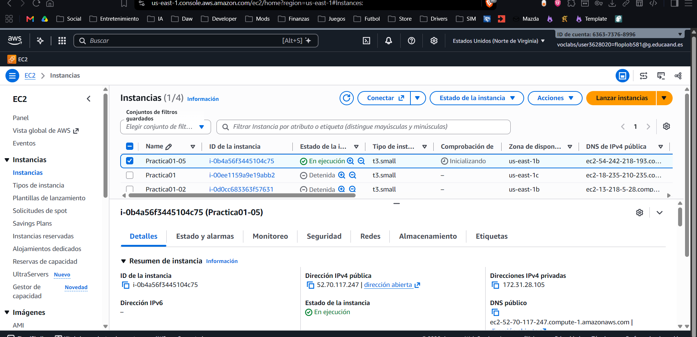

### Grupo de seguridad

| Puerto | Protocolo | Uso |
|---|---|---|
| 22 | TCP | SSH |
| 80 | TCP | HTTP (necesario para el reto de Let's Encrypt y para la redirección) |
| 443 | TCP | HTTPS |

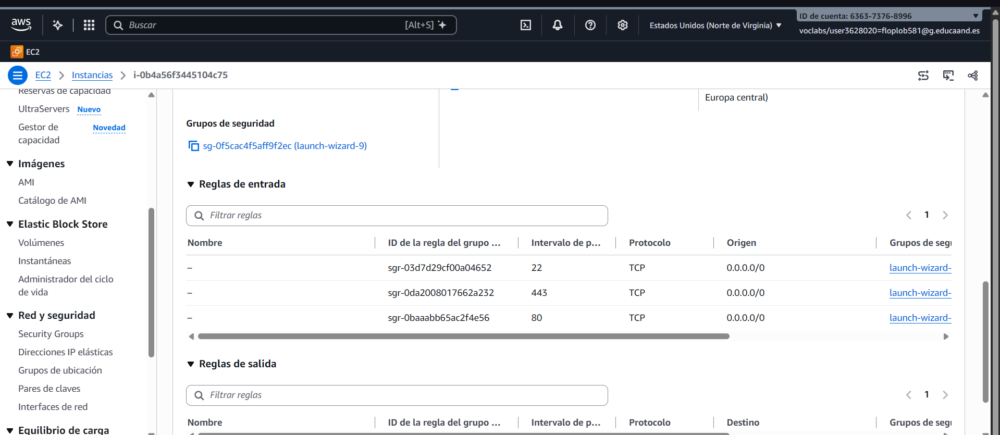

### IP elástica

Se asocia una IP elástica a la instancia para que su dirección pública no cambie al detenerla. Esto es importante en esta práctica, porque si la IP cambiara, el dominio dejaría de apuntar al servidor.

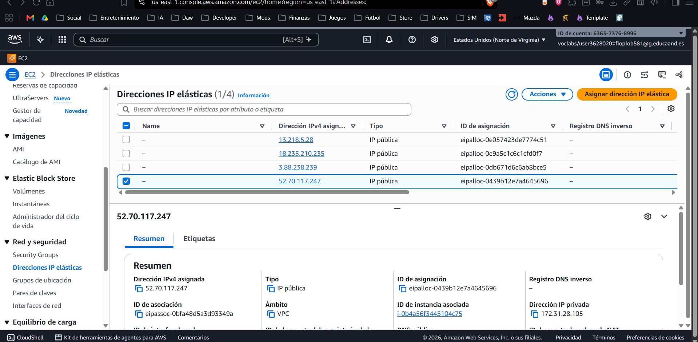

---

## 3. Registro del dominio y DNS

Se registra un dominio gratuito en **No-IP**: `fran-https.ddns.net`, con un registro de tipo **A** que apunta a la IP elástica de la instancia.

| Tipo | Host | Valor |
|---|---|---|
| A | `fran-https.ddns.net` | `52.70.117.247` |

> En la cuenta gratuita de No-IP no se puede crear el registro `www.` sobre un subdominio de `ddns.net`, así que el certificado se emite solo para `fran-https.ddns.net`.

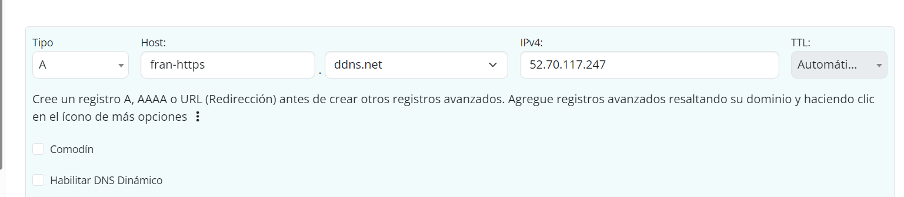

Después se comprueba la propagación del DNS en [dnschecker.org](https://dnschecker.org): los servidores de todo el mundo ya devuelven `52.70.117.247`.

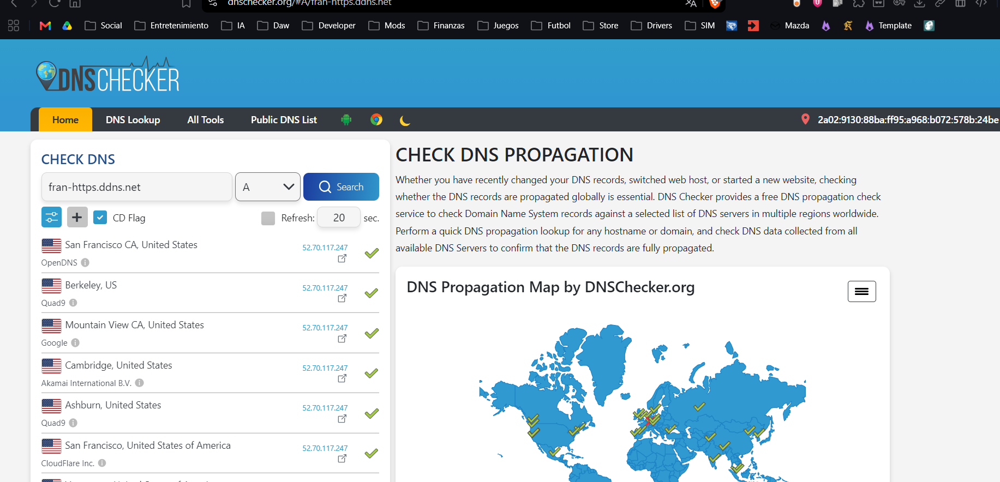

También se puede comprobar desde la terminal, consultando al DNS de Google:

```powershell
nslookup fran-https.ddns.net 8.8.8.8
```

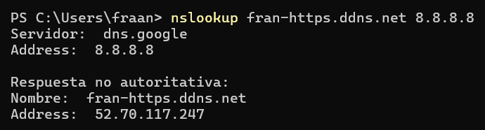

---

## 4. Estructura del repositorio

```
.
├── README.md
├── .gitignore
├── .gitattributes
├── conf
│   └── 000-default.conf
├── img
└── scripts
    ├── .env.example
    ├── install_lamp.sh
    └── setup_letsencrypt_certificate.sh
```

| Archivo | Función |
|---|---|
| `conf/000-default.conf` | VirtualHost del puerto 80 con el `ServerName` que necesita Certbot |
| `scripts/install_lamp.sh` | Instala Apache, PHP y MySQL (reutilizado de prácticas anteriores) |
| `scripts/setup_letsencrypt_certificate.sh` | Instala Certbot, obtiene el certificado y configura HTTPS en Apache |
| `scripts/.env.example` | Plantilla de las variables de configuración |
| `.gitattributes` | Fuerza los saltos de línea LF en los scripts para que funcionen en Linux aunque se editen en Windows |

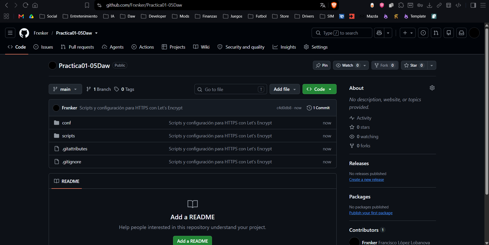

---

## 5. Variables de configuración (.env)

Las variables se guardan en `scripts/.env`. Este archivo no se sube al repositorio (está en `.gitignore`); en su lugar se incluye `.env.example`.

```
LE_EMAIL=tu_email@ejemplo.com
LE_DOMAIN=fran-https.ddns.net
```

| Variable | Uso |
|---|---|
| `LE_EMAIL` | Email al que Let's Encrypt envía los avisos de caducidad |
| `LE_DOMAIN` | Dominio para el que se emite el certificado |

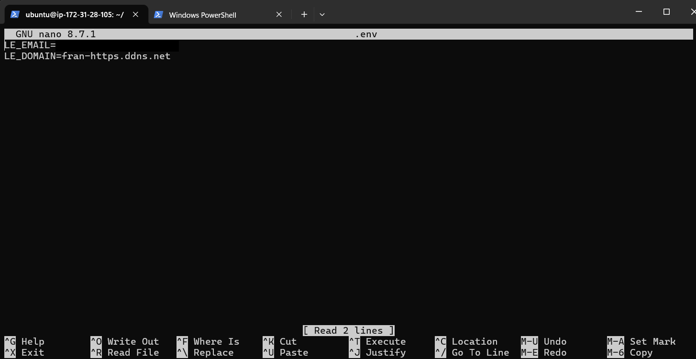

---

## 6. Instalación de la pila LAMP

Se conecta a la instancia por SSH, se clona el repositorio, se crea el `.env` y se ejecuta `install_lamp.sh`, el mismo script de las prácticas anteriores:

```bash
ssh -i vockey.pem ubuntu@52.70.117.247
git clone https://github.com/Frxnker/Practica01-05Daw.git
cd Practica01-05Daw/scripts
cp .env.example .env
nano .env
chmod +x *.sh
sudo ./install_lamp.sh
```

El script actualiza el sistema e instala Apache (con el módulo `rewrite` habilitado), PHP y MySQL Server.

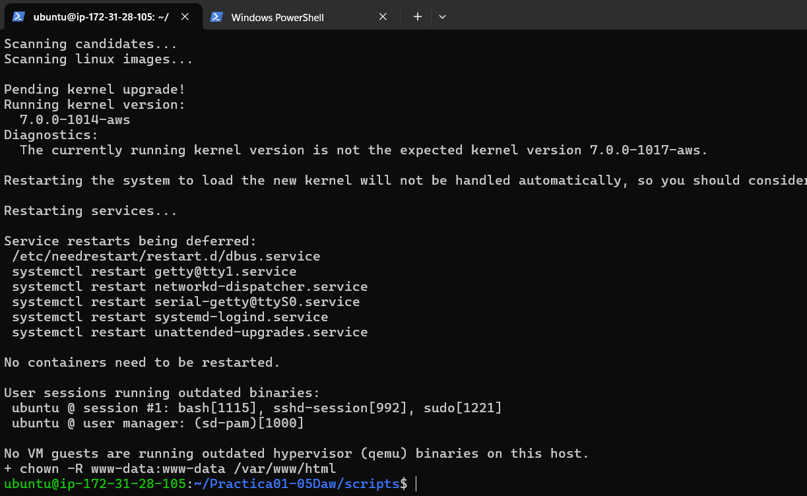

En este momento el sitio solo funciona por HTTP, y el navegador lo marca como **"No es seguro"**:

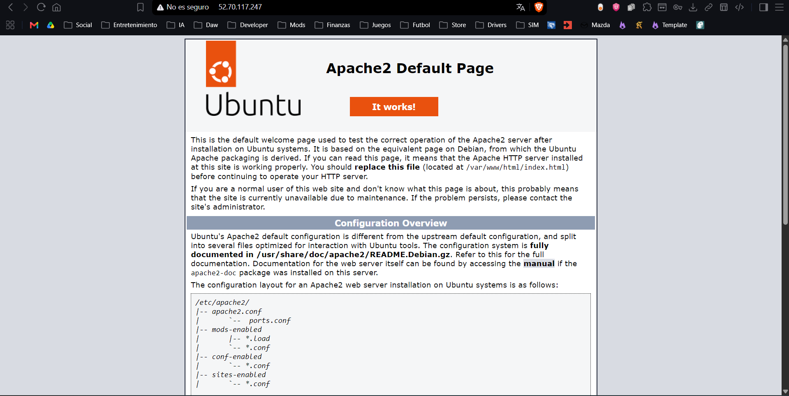

---

## 7. Obtención del certificado con Certbot

Script: `scripts/setup_letsencrypt_certificate.sh`

```bash
sudo ./setup_letsencrypt_certificate.sh
```

### 7.1. VirtualHost con el dominio

Certbot busca en Apache el VirtualHost cuyo `ServerName` coincide con el dominio. Por eso el script copia `conf/000-default.conf` y sustituye `PUT_YOUR_DOMAIN_HERE` por el valor de `LE_DOMAIN`:

```apache
<VirtualHost *:80>
    ServerName PUT_YOUR_DOMAIN_HERE
    DocumentRoot /var/www/html
    DirectoryIndex index.php index.html
</VirtualHost>
```

```bash
cp ../conf/000-default.conf /etc/apache2/sites-available/000-default.conf
sed -i "s/PUT_YOUR_DOMAIN_HERE/$LE_DOMAIN/" /etc/apache2/sites-available/000-default.conf
systemctl reload apache2
```

A diferencia de la práctica 1.4, este archivo **no incluye la redirección a HTTPS**, porque la añade Certbot.

### 7.2. Instalación de Certbot

Se instala con `snap`, como recomienda la documentación oficial:

```bash
snap install core
snap refresh core
apt remove certbot -y
snap install --classic certbot
ln -fs /snap/bin/certbot /usr/bin/certbot
```

| Comando | Función |
|---|---|
| `snap install core` / `snap refresh core` | Instala y actualiza el núcleo de snap |
| `apt remove certbot` | Elimina versiones antiguas instaladas con `apt` para evitar conflictos |
| `snap install --classic certbot` | Instala Certbot |
| `ln -fs /snap/bin/certbot /usr/bin/certbot` | Crea un enlace para poder ejecutar `certbot` desde cualquier ruta |

### 7.3. Solicitud del certificado

Normalmente `certbot --apache` hace varias preguntas. Para automatizarlo, las respuestas se pasan como parámetros:

```bash
certbot --apache \
  -m "$LE_EMAIL" \
  --agree-tos \
  --no-eff-email \
  -d "$LE_DOMAIN" \
  --non-interactive
```

| Parámetro | Significado |
|---|---|
| `--apache` | Usa el plugin de Apache: obtiene el certificado y además configura Apache |
| `-m` | Email de contacto |
| `--agree-tos` | Acepta los términos del servicio |
| `--no-eff-email` | No comparte el email con la EFF |
| `-d` | Dominio para el que se pide el certificado |
| `--non-interactive` | No hace ninguna pregunta, imprescindible para usarlo en un script |

Resultado: Let's Encrypt emite el certificado, válido hasta el **7 de febrero de 2027**, y Certbot lo instala en Apache y activa HTTPS.

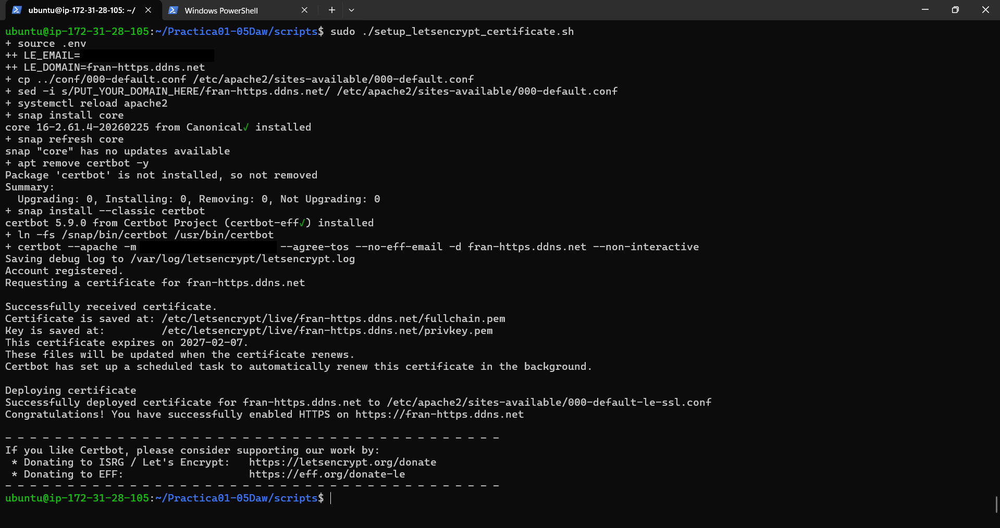

---

## 8. Cambios que hace Certbot en Apache

### 8.1. Redirección de HTTP a HTTPS

Certbot modifica `000-default.conf` para redirigir todas las peticiones HTTP a HTTPS:

```apache
<VirtualHost *:80>
    Include /etc/apache2/le_http_01_challenge_pre.conf
    ServerName fran-https.ddns.net
    DocumentRoot /var/www/html
    DirectoryIndex index.php index.html
    RewriteEngine on
    RewriteCond %{SERVER_NAME} =fran-https.ddns.net
    RewriteRule ^ https://%{SERVER_NAME}%{REQUEST_URI} [END,NE,R=permanent]
    Include /etc/apache2/le_http_01_challenge_post.conf
</VirtualHost>
```

| Directiva | Función |
|---|---|
| `RewriteEngine on` | Activa el motor de reescritura de URLs |
| `RewriteCond %{SERVER_NAME} =fran-https.ddns.net` | La regla solo se aplica a peticiones a este dominio |
| `RewriteRule ^ https://...` | Redirige a la misma ruta pero con `https://` |
| `[END,NE,R=permanent]` | Redirección permanente (301), sin escapar caracteres y sin procesar más reglas |
| `Include le_http_01_challenge_*.conf` | Permite que Let's Encrypt acceda por HTTP a los archivos del reto al renovar |

### 8.2. VirtualHost HTTPS

Certbot crea y habilita `/etc/apache2/sites-available/000-default-le-ssl.conf`, y activa el módulo `ssl`:

```apache
<IfModule mod_ssl.c>
<VirtualHost *:443>
    Include /etc/apache2/le_http_01_challenge_pre.conf
    ServerName fran-https.ddns.net
    DocumentRoot /var/www/html
    DirectoryIndex index.php index.html
    SSLCertificateFile /etc/letsencrypt/live/fran-https.ddns.net/fullchain.pem
    SSLCertificateKeyFile /etc/letsencrypt/live/fran-https.ddns.net/privkey.pem
    Include /etc/letsencrypt/options-ssl-apache.conf
    Include /etc/apache2/le_http_01_challenge_post.conf
</VirtualHost>
</IfModule>
```

| Directiva | Función |
|---|---|
| `<VirtualHost *:443>` | El sitio escucha en el puerto 443 (HTTPS) |
| `SSLCertificateFile` | Certificado del dominio más el intermedio de Let's Encrypt (`fullchain.pem`) |
| `SSLCertificateKeyFile` | Clave privada (`privkey.pem`) |
| `Include options-ssl-apache.conf` | Opciones de TLS recomendadas por Certbot (protocolos y cifrados seguros) |

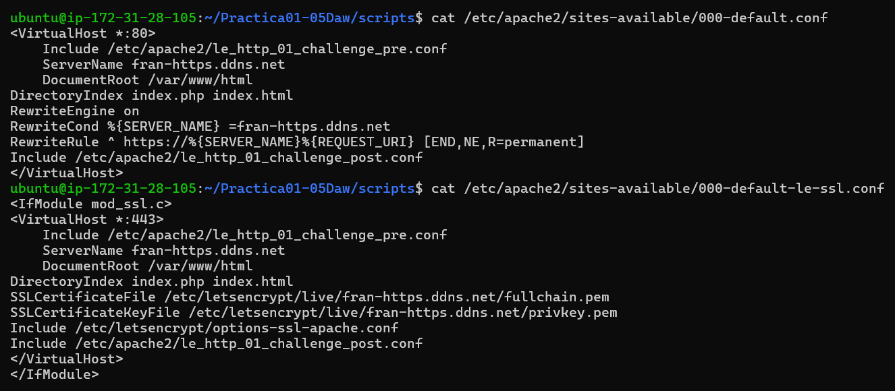

### 8.3. Archivos del certificado

Los certificados se guardan en `/etc/letsencrypt/live/fran-https.ddns.net/`:

| Archivo | Contenido |
|---|---|
| `cert.pem` | Certificado del dominio |
| `chain.pem` | Certificado intermedio de Let's Encrypt |
| `fullchain.pem` | `cert.pem` + `chain.pem` |
| `privkey.pem` | Clave privada |

---

## 9. Comprobación

### 9.1. Certificado instalado y renovación automática

```bash
sudo certbot certificates
systemctl list-timers | grep -i certbot
```

El certificado es de tipo **ECDSA**, es válido durante **90 días** y caduca el 07/02/2027. Certbot ha creado el temporizador `snap.certbot.renew.timer`, que comprueba dos veces al día si hay que renovarlo.

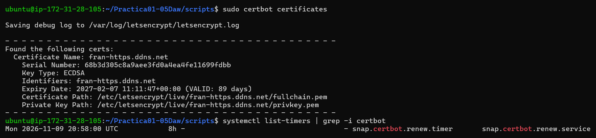

Se simula una renovación para comprobar que funcionará cuando llegue el momento:

```bash
sudo certbot renew --dry-run
```

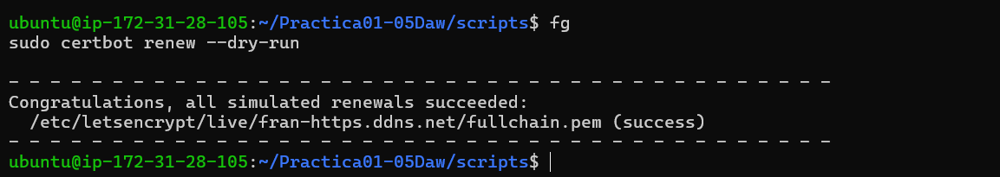

### 9.2. Redirección HTTP → HTTPS

```bash
curl -I http://fran-https.ddns.net
```

El servidor responde con `301 Moved Permanently` y la cabecera `Location: https://fran-https.ddns.net/`.

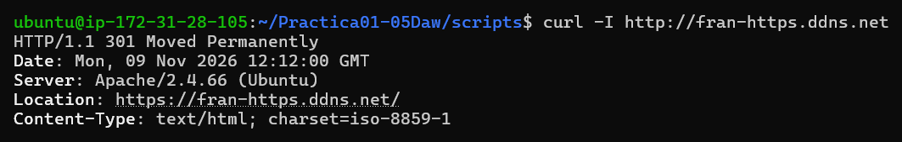

### 9.3. Acceso desde el navegador

Al entrar en `https://fran-https.ddns.net` la página carga **sin ningún aviso**, a diferencia del certificado autofirmado de la práctica 1.4:

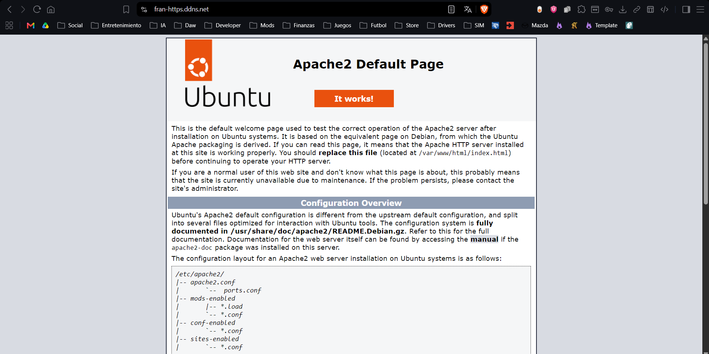

El navegador indica que la conexión es segura y que el certificado es válido:

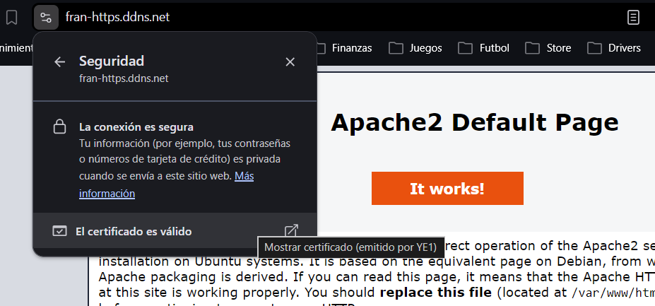

En los datos del certificado se ve que lo ha emitido **Let's Encrypt** (intermedio `YE1`) para `fran-https.ddns.net`, con validez del 09/11/2026 al 07/02/2027:

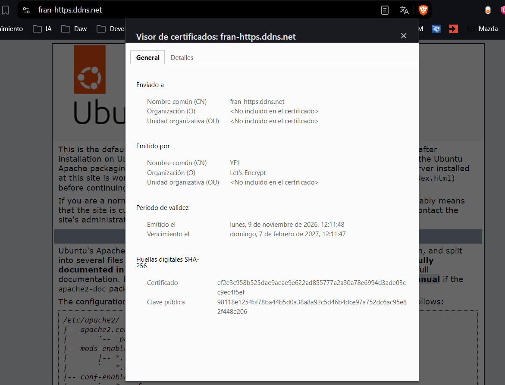

---

## 10. Cómo reproducir el despliegue

Requisitos: una instancia Ubuntu Server con los puertos 22, 80 y 443 abiertos y un dominio con un registro A que apunte a su IP.

```bash
git clone https://github.com/Frxnker/Practica01-05Daw.git
cd Practica01-05Daw/scripts
cp .env.example .env
nano .env                 # email y dominio
chmod +x *.sh
sudo ./install_lamp.sh
sudo ./setup_letsencrypt_certificate.sh
```

> Los scripts usan rutas relativas (`../conf`), así que deben ejecutarse desde dentro de la carpeta `scripts`.

---

## Referencias

- [Enunciado de la práctica](https://josejuansanchez.org/iaw/practica-https/index.html)
- [Let's Encrypt · Cómo funciona](https://letsencrypt.org/es/how-it-works/)
- [Certbot · Instrucciones para Apache](https://certbot.eff.org/instructions?ws=apache&os=snap)
- [No-IP](https://www.noip.com)
- [DNS Checker](https://dnschecker.org)